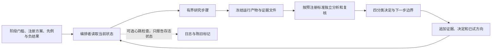

# AutoResearch 参考架构审计与 NeuroTopo 适配

审计日期：2026-09-23。目的在于提炼可复用的长程研究流程，不评估论文写作产量，也不据此提出 NeuroTopo 的新颖性或能力主张。

## 来源与可复用状态

- [论文目录页](https://victorchen96.github.io/auto_research/paper.html) 汇总四篇自述产出；[框架页](https://victorchen96.github.io/auto_research/framework.html) 是长时程研究协议，页面包含完整 Markdown 规范；[paper-writing 技能组页](https://victorchen96.github.io/auto_research/skill/paper-writing.html) 描述文献、写作、实验、图表和模拟审稿分工。后两者提供方法文本与流程图，未提供可执行的原始编排器、实验运行器或守护进程。[作者 GitHub 主页仓库](https://github.com/victorchen96/victorchen96.github.io) 可见这些静态网页材料，没有发现配套自动研究运行时代码或根目录许可证。
- 页面将框架称为开源协议，但没有显示上游许可证类型。[公开的协议镜像](https://github.com/ziwangprincex/deli-autoresearch-skill-protocol) 自带 MIT 许可，同时说明其内容是协议技能而非执行代码；许可只属于该仓库，不能据此推定上游许可。[Daybreak 衍生协议](https://github.com/1dZb1/Daybreak-AutoResearch) 也明确记载未找到上游许可，并单独为自身改编标注 Apache-2.0。故本记录只链接并概述设计，不复制技能全文、模板或代码；若要再分发原文，须先解决来源许可。
- 两个主页面汇报的早期论文评分并不一致：目录页给出 8.5/10，框架页称早期论文自评为 8.0/10。框架页说明分数来自同一系统内的多角色模拟评审，只能作该协议内的迭代信号；不能称作真实同行评审或独立质量验证。作者的[项目说明](https://github.com/victorchen96/victorchen96.github.io/blob/main/blog_auto_research_v2.html) 还指出若干检索、评审和实验设计技能仍为内部组件。

## 架构评估

原协议把任务状态写入文件，由编排者读取进度、已试方向与发现，再安排有界工作步骤；执行与评估分离，结果和方向记录追加保存，停滞时改变研究方向，并用心跳记录任务是否还活着。其文档还提出独立守护与定时巡检，但没有附带实现这些行为的运行时代码。

NeuroTopo 已出现一个本地可执行的**证据门控流程账本**：[loop.py](../src/neurotopo/loop.py) 记录 `QUESTION → PRIOR_ART → CRITIQUE → REGISTERED → VALIDATED → RUNNING → ANALYZED → REVIEWED → DECIDED`，对证据文件保存 SHA-256 引用，以追加日志维护发现，并要求重复方向显式登记为复现。它记录研究者执行的工作，不会自行提出假设、启动实验、派发 agent、做独立评审或调度长期任务。`heartbeat` 与 `watchdog` 写入/报告心跳和陈旧状态；代码没有自动重启、cron、邮件或发布能力。本次为源码审阅，没有运行该 CLI。

## NeuroTopo 的逐步适配

1. **QUESTION**：从 [stage gates](../research/stage_gates.md)、研究问题和未解决的最强反驳开始，确认当前门槛允许回答什么。Gate 1 仍未通过时，不启动后续机制来挽救架构主张。
2. **PRIOR_ART / CRITIQUE**：按[先例矩阵](../research/prior_art/evidence_matrix.md) 核对机制近似、匹配基线、来源缺口和最强替代解释。独立工作步骤只接收必要背景、一个可核验交付物、路径范围和完成标准。
3. **REGISTERED / VALIDATED**：先冻结实验版本、假设、对照、种子、主要指标、阈值、排除规则和资源账本；再验证实现等价、随机性、泄漏、形状梯度、学习底线和资源匹配。协议变更生成新版本，旧注册与失败记录保留。
4. **RUNNING / ANALYZED / REVIEWED**：只运行已冻结方案；保留所有种子、失败和偏差。分析按已注册单位与规则进行，独立复核检查证据链及反例，不用模拟评审分数替代科学判据。
5. **DECIDED / PIVOT**：只作 `SUPPORTED`、`PARTIALLY_SUPPORTED`、`INCONCLUSIVE` 或 `FALSIFIED` 判断。结果是否推进取决于信息是否回答了注册问题；负结果也算研究进展。若确需结构性转向，先写入方向记录，再登记新方案，不因指标下降而自动改任务、加机制或反复调参。
6. **HEARTBEAT**：记录回调时间并检查陈旧状态。心跳只证明账本收到回调；长时调度器是否可用尚未确认。不要根据框架页建议推定本机有可靠 cron，也不自动重启需付费的 agent、发送邮件或发布结果。

## 采纳边界

优先采用持久化的精选状态、追加式证据、执行与评估分离、明确的复现标记、有界工作步骤、停滞后的方向检查和轻量心跳。新方向必须服从 [NeuroTopo 实验协议](experiment_protocol.md) 与当前门槛。若未来接入多 agent，工作者负责一个有界交付物，独立评审者核验证据，编排者整合；这些角色划分目前属于流程约定，账本没有自动派工实现。

当前最强未解决问题仍是 delay-8 学习不足：EXP-0001 v2 为 `INCONCLUSIVE`，EXP-0002 v1 只支持 delay-0 可学性，Gate 1 保持关闭。它约束下一轮任务选择；模拟评审分数、单次心跳或账本阶段完成都不会改变该证据状态。

## 本轮实现补充

审计后已加入 `neurotopo.loop_worker`，可从 VALIDATED 状态实际启动冻结 study、周期心跳、超时监控、固定分析并推进到 ANALYZED。科研设计与独立评审仍由当前 Codex 会话执行；没有声称跨会话无人值守推理。详见 [工作流](auto_research_workflow.md)。
