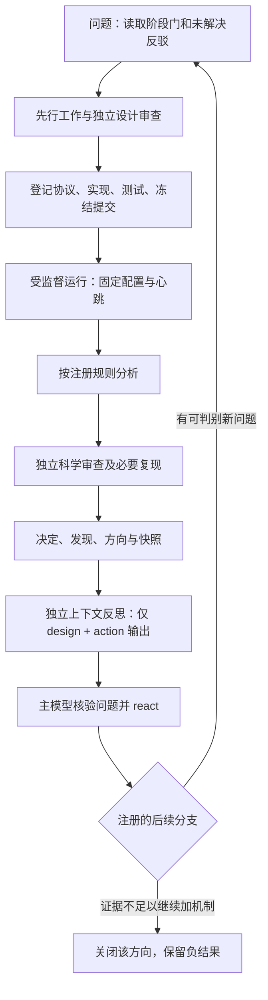

# NeuroTopo 可执行研究循环

2026-09-29 现行科学主张阶段门为 `ARCH-GATES-v1`（`research/stage_gates.md`，决定0101）。本文件下述 `gate1_candidate_first_v2` 入口、迁移命令和 Gate 1 规则仅用于旧 ResearchLoop 合同；它们不办理新 A0–A6 的自动晋级。新架构候选须另行冻结协议并按新门裁决，不得借旧 `project_gate1` 字段取得资格。

2026-09-26 恢复说明：旧入口代码为 `gate1_candidate_first_v2`（已生效的决定0080）。历史账本若仍为v1，只能在DECIDED且反思完成后，显式执行 `python -m neurotopo.loop migrate-entry-policy --from-policy gate1_candidate_first_v1 --policy gate1_candidate_first_v2 --authority research/decisions/0080_entry_rule_architecture_organization.md`。它追加有授权哈希的迁移事件，不修改旧实验；下文v1段落保留为历史启用过程。`workflow=orbit_information` 是EXP-0015的300秒零训练任务信息筛查，成功不放行旧模型训练或旧Gate1，失败关闭固定任务配置。

设计来源与取舍见 [参考审计](auto_research_reference.md)。本项目实现由当前 Codex 编排者、持久化状态机和受监督实验进程组成；独立 agent 负责关键审查。没有安装跨会话 cron 或后台付费模型服务。



## 职责与事实记录

`neurotopo.loop` 强制九阶段顺序，证据文件存在且非空，并记录其 SHA-256。语义正确性由独立审查负责；通过文件检查不意味着科学主张成立。`neurotopo.loop_worker` 从 VALIDATED 阶段启动已登记的 study，维护心跳、限制单项任务时间并在训练后执行固定分析。它停在 ANALYZED，编排者收到独立评审后才能写 REVIEWED 与 DECIDED。`DECIDED` 后还有独立反思与主模型 reaction 的归档门；完成后才可开始下一轮。旧账本在首次归档反思后启用此门。

已登记的 `workflow=study` 执行训练研究，`workflow=replay` 执行固定权重的输入干预及其预注册分析。两种类型均经过相同的阶段门、冻结源码验证和独立结果审查；`replay` 不训练或替换原检查点。

`workflow=probe` 对冻结模型的隐状态拟合独立的固定线性岭回归读出，先检验原模型输出重放及训练/验证/测试隔离，再执行预注册的种子层分析。探针训练不更新原循环模型，结果只涉及该探针家族可访问的信息。

`workflow=final_probe` 在原模型完成 late selector 与最终 QUERY 更新之后提取冻结状态。confirm/revise 两条反事实 sibling 按 pair 整组进入同一数据拆分，主终点只统计 revise 的最终标签线性读出；不会训练或修改原循环模型。

`workflow=transfer_probe` 仍使用冻结权重，并比较同一线性读出跨延迟迁移与目标延迟单独拟合的结果。源、目标头的重拟合波动分别审核；所有头的尺度参数来自同一短延迟训练状态。它不能代替原模型任务读出的因果干预。

`workflow=source_belief` 对带解析八类联合后验的任务运行已登记的分块、保度重连及宽稠密 GRU。训练 batch 在同一种子内由三臂共享，执行前检查十个图、初值、数据流和资源；分析只按冻结的 d=4 配对种子规则判定。为了隔离挂载卷中无关的未跟踪产物，`loop_worker --output <绝对路径>` 可从干净已提交 checkout 执行，将产物写到原仓库的新目录；这不改变配置哈希或结果来源提交。EXP-0009 依此流程完成，控制 headroom 不足而判 INCONCLUSIVE。

STR-0002 后的**新 QUESTION 入口**使用 `gate1_candidate_first_v1` 结构策略。它只检查合同字段和 claim track，不能代替先例或独立科学批评。当前 live 账本已在 ITER-0007 `DECIDED` 且反思完成后一次性启用；其他旧账本须满足同样条件。启用后 `begin` 必须附事前 JSON 合同并保存其内容哈希。`project_gate1` 缺候选因素会拒绝；`independent_benchmark` 可无候选或带独立因素但必须有自身问题、预算与成败分支；参考 K 因子可走 `field_reference`，其项目过门资格仍需前瞻裁定。合同还限制候选提出后任务配置数，要求保留全部尝试和未参与选择的验证规则。入口通过只到 `QUESTION`，不授权训练。

结构合同通过后，还要由独立批评核对任务菜单是否在筛查前固定、资源匹配计划是否真实、三分支能否改变所声明的决定。参考 `artifacts/validation/str0002_entry_dryrun.json` 的四个**流程样例**：缺候选项目申请拒绝且事件数不变；独立 benchmark 与领域参考问题可以进入；参考 K 因子对项目过门仍返回资格未决。样例不是科学候选或正式 EXP 注册，绿色测试只证明入口代码按这些规则分流。

原始产物和协议不可覆盖。运行中的可变日志放在 `artifacts/auto_research/live`，由 Git 忽略；每轮结束将状态快照、评审和决定保存到 `research/iterations/`。正式实验仍要求工作树干净和源码验证匹配。已有实验从不因为循环改变解释或阈值。

执行 agent 与评审 agent 使用不同上下文。工作包仅含任务、当前阶段、已试方向、必要源码/协议/证据和完成条件。每个角色只有明确的写入路径；避免多个 agent 同写状态。模型角色由 mixed-model-orchestration 路由，任何新增外部提供商仍需现有授权。

## 日常入口

使用 `docs/reproduction.md` 中的本地虚拟环境。初始化后，下一会话先读 `loop status`、阶段门和最新归档，不重跑已完成任务。
`research/loop/task_spec.md` 是初始化时哈希固定的历史任务说明；当前可执行研究前沿和客观重开触发读 `research/loop/current_frontier.md`，不能用旧 spec 中的 EXP-0003 顺序覆盖后续冻结负结果。

```sh
python -m neurotopo.loop init --task-spec research/loop/task_spec.md
python -m neurotopo.loop status
python -m neurotopo.loop begin --direction payload-x-curriculum --question 'Can training conditions resolve delayed-task learning?' --experiment EXP-0003
python -m neurotopo.loop advance --phase PRIOR_ART --evidence research/prior_art/learning_conditions.md
python -m neurotopo.loop advance --phase CRITIQUE --evidence docs/EXP-0003_pre_run_review.md
python -m neurotopo.loop advance --phase REGISTERED --evidence experiments/EXP-0003/v2.md
# 实现、验证并提交后：
python -m neurotopo.loop advance --phase VALIDATED --evidence artifacts/validation/suite.json
python -m neurotopo.loop_worker --config configs/exp0003_v2.json
```

评审后继续 `advance --phase REVIEWED --evidence <review>`，再以四分类判定、具体发现和后续动作推进 DECIDED。随后用 `python -m neurotopo.reflection packet --design <registered.md> --action <analysis.json> --output <packet.json>` 创建最小输入；需要验证任务完成前置条件时，可附加 `--action-output verification=<verification.json>` 等已完成 action 输出。在新的独立上下文获得 `review.json`，主编排者核验并形成 `reaction.json`，再执行 `python -m neurotopo.loop reflect --packet <packet.json> --review <review.json> --reaction <reaction.json>`。具体字段和边界见 [任务后反思](post_task_reflection.md)。最后执行 `snapshot --output research/iterations/ITER-0001/state.json`。上述是协议示例；已有阶段不可回退或重复执行新运行。watchdog 只记录陈旧状态，不重启 agent 或修改科学决定。

上面的 `EXP-0003` 命令是**入口策略启用前**的历史示例。对当前项目的下一轮，在已有反思完成后先启用并检验合同，再开始 QUESTION；以下 `EXP-9010` 仅示例命令，需替换为真实已审查的合同和新实验 ID：

```sh
python -m neurotopo.loop enable-entry-policy --policy gate1_candidate_first_v1
python -m neurotopo.entry_policy --contract research/entries/EXP-9010.json --experiment EXP-9010 --direction candidate-factor --question 'Registered candidate question'
python -m neurotopo.loop begin --direction candidate-factor --question 'Registered candidate question' --experiment EXP-9010 --entry-contract research/entries/EXP-9010.json
```

## 推进原则

新信息可以是有用的负结果。没有新发现的轮次单独标记，两轮触发方向审查；不得用更换方向名称规避重复实验，也不得把得分下降当作必须改出正结果的理由。复现方向须显式标记。后续研究始终受原有阶段门约束：可学习性恢复只允许重新检验架构效应，不能直接引入适应、通信、生物拓扑或语言模型。

每次在 `问题 → 先行工作` 之间先写**决策价值表**：若结果成功、失败或贴近阈值，各自会改变哪个当前决定？STR-0002 后，项目 Gate 1 动机的任务资格训练先要有具名候选或参考 K 因素、可消融预测与真实主匹配控制，然后才找独立余量；候选缺席时不连续启动 CAL 配置来寻找“刚好不封顶”的任务。独立领域 benchmark 可以另问，只需独立目的、预算与停止分支，不把其资格冒充项目 Gate 1。反思若发现阻碍由任务/对照选择策略造成，应在下一次注册前实际改入口条件，并保留旧结果。

## 当前实现与归档边界

已实跑的训练及固定分析由 `loop_worker` 自动衔接，每5秒记录存活状态，单项任务默认上限1800秒；模型提出问题、源码修改和语义评审仍由当前 Codex 编排者及独立上下文完成。退出当前会话不会继续产生新的研究假说或模型调用。

阶段证据记录的是当时文件的哈希。可变公共验证报告后来更新时，可在该轮 manifest 所指 Git 提交中查验原版本；manifest 也嵌入当轮验证记录。运行阶段的临时任务描述及完整日志同时复制进该轮 `runtime/` 归档，避免只留下忽略目录中的路径。

## 收尾的存活检测修正

两轮完成后，实际检查发现旧watchdog会把长期处于DECIDED的已完成任务标成stale。已修正为只对活动阶段判陈旧，并添加“完成两天后仍不算卡住”的回归测试。此项仅改变运行监督状态；EXP-0004的科学执行与独立复现均固定在eec9ca4，未重写结果。当前完整验证为32项通过，冻结实验提交的独立验证为31项通过。
