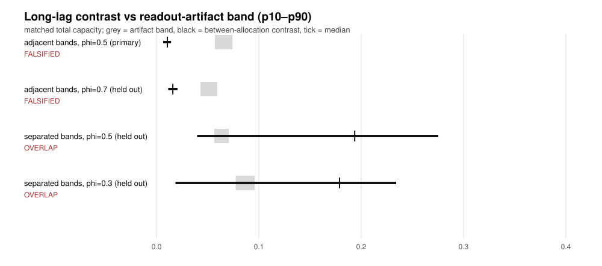
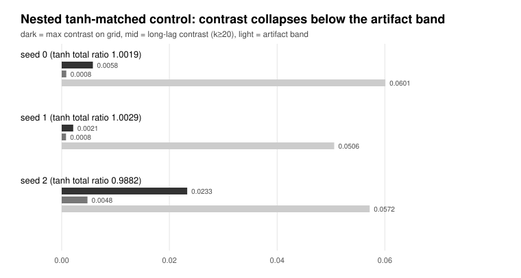

# Matched total capacity does not identify a recurrent core's organisation: a specification-curve study with a between-arm null

**A specification-curve study of timescale allocation with exact infinite-horizon capacity**

Draft v1 — 2026-09-24. Target: workshop / short methods paper (methodological + negative result).
**No capability claim, no neuroscientific claim, no Gate 1 claim.** Every number is produced by the scripts
listed in `paper/dir0003_repro_manifest.json`; none is quoted from memory.

---

## Abstract

Architecture and connectome comparisons routinely match one resource summary — parameters, FLOPs, or a
capacity measure — and then read a single scalar performance difference. We ask when such a match can
identify anything at all. Working with a frozen linear recurrent core under an AR(1) input law, we compute
the **exact infinite-horizon memory-capacity functional in closed form** (no horizon truncation), enumerate
*all* allocations of 64 units across three declared timescale bands whose total capacity matches a reference,
and build a specification curve over input-weight seeds and readout ridge values. The matched family is large
— 510–1410 distinct allocations per specification — so a matched scalar leaves wide organizational freedom.
Whether that freedom is *visible* depends on which null it is compared against, and getting that null right
changes the answer. A between-arm **realisation null** — two arms with identical organisation and identical
ridge, differing only in the input-weight realisation — has median 0.024–0.027 and p90 0.056–0.062 on the lag
grid and median 0.006–0.014 at long lags, i.e. it is two to five times *smaller* than the within-arm ridge
sensitivity (median 0.131) we first used as a threshold. Against the realisation null, the typical matched
organisation is only about 1.5–2 times the null (0.042 adjacent, 0.062 separated) and the long-lag contrast
sits at the null's own p90, so, like for like, no geometry and no correlation time yields a separable effect at this sample
size. The large separated-band contrasts (median 0.26) are extrema selected over a matched family whose median size
differs by a factor of 27 between geometries (33 versus 906). A rank test shows that the selection criterion is
*informative* rather than arbitrary — the member chosen by the second-moment criterion sits at rank fraction
0.862 (adjacent) and 0.996 (separated) inside its family, with Fisher statistics 39.4 and 241.2 on 16 degrees of
freedom, and about 2.1 and 5.1 times the family median — but a maximum over candidates is still not comparable
with a single-draw null, and once a second moment is matched the best contrast available falls back to
0.024–0.047, i.e. to the null's own level. An R1 control that also matches the first moment of the log-timescale distribution leaves
short-lag contrasts up to 0.20 but long-lag contrasts ≤ 0.023; a tanh-core control shows both that capacity matching is **not portable across core classes** (a linearly
matched pair has total ratio 0.82–0.88 in one run and 0.72–0.89 in another under a static nonlinearity) and
that, once re-matched inside the nonlinear core by the same selection rule, its contrasts sit at or just above
the realisation null (0.0048–0.0160 against a null p90 of 0.009) rather than an order of magnitude below it. We give a pre-registration recipe: measure the artifact band first, report contrasts as
distributions over a speci- fication curve, and treat a matched-summary comparison as identifying only when
the effect provably exceeds that band — a property to be measured per construction, not assumed.

## 1. Why matched comparisons fail to identify mechanisms

Six confounds recur in resource-matched architecture comparisons: representational simulability (a matched
dense model can represent a structured one), the conflation of capacity and optimization error, task
affordance, control saturation, hard-coded identity, and readout/probe capacity. Our own programme closed
fifteen candidate mechanisms, every one on an identification or feasibility ground rather than on a clean
effect measurement, and two pre-designs were rejected in independent packet-only adversarial reviews with 17
issues each (both retained, with verbatim findings and our retractions, in the source repository). The
methodological literature we audited agrees on the shape of the problem: *level* differences are absorbed by
tuning budget, benchmark choice and readout choice, while *shape* quantities — exponents, non-monotone
critical lines, transition counts and locations — are not, provided the effect survives the measurement band.
This paper makes that band explicit, measures it, and reports which conclusions survive it.

### 1.1 Related work (only sources retrieved in this project's audit)

Citations below were retrieved with `curl` during this project's prior-art audit (arXiv API, arXiv abstract
pages, Crossref, Europe PMC, publisher pages) and are reproduced from the retrieval records; the verification
layer of each is noted because the audit's rule is that a source may only be cited for what was actually read.

**Resource-matched comparison methodology.** *The Efficiency Misnomer* (arXiv:2110.12894, full PDF read)
documents that parameter-matched and FLOP-matched comparisons are not equivalent and that conclusions can
reverse across cost indicators, and recommends showing several matched setups rather than one. *The Benchmark
Lottery* (arXiv:2107.07002, PDF read) shows rankings changing with the benchmark suite. *On the State of the
Art of Evaluation in Neural Language Models* (arXiv:1707.05589, abstract) and *A Metric Learning Reality
Check* (arXiv:2003.08505, abstract) report that claimed architectural gains shrink or vanish under equal
tuning effort. *Show Your Work* (arXiv:1909.03004, abstract) proposes reporting best-found performance as a
function of tuning budget; *Tensor Programs V* (arXiv:2203.03466, abstract) makes per-arm optimal
hyperparameters transferable across scale; *Training Compute-Optimal Large Language Models*
(arXiv:2203.15556, abstract) compares architectures along a compute frontier rather than at a single budget.

**Capacity as a functional of organisation.** The information-processing-capacity framework
(doi:10.1038/srep00514, abstract-and-text layer in our audit) bounds the total capacity of a dynamical system
by its state dimension, so a structural difference can only appear as a *redistribution* across basis
functions rather than as a larger total. Reservoir studies report organisation-dependent redistribution with
sign flips across unit nonlinearities (doi:10.1162/netn_a_00082) and hierarchical-modular reservoirs
(doi:10.1038/s41467-026-74466-2), while arXiv:2012.01409 and arXiv:2607.17909 caution against the common
assumption that optimal computation sits at a particular stability boundary. Our study is a direct
instantiation of the redistribution view under an exact, untruncated capacity functional.

**Causal tests of modularity.** *Is a Modular Architecture Enough?* (arXiv:2206.02713) adds a
ground-truth-oracle arm to separate a potential gap from an optimisation gap; *Are Neural Nets Modular?*
(arXiv:2010.02066) contrasts shared and separated input/output interfaces; a pre-registered causal test of
mixture-of-experts modularity (arXiv:2606.25092) requires an effect to beat a size-matched random null and
adds a selectivity criterion; arXiv:2604.09780 argues that routing geometry can reproduce apparent
specialisation. Our artifact band plays the role those controls play for training-time comparisons, but for a
*readout*-driven contrast.

**Design devices.** Negative-control outcomes (doi:10.1093/ije/dyag163), equivalence testing for null results
(doi:10.7554/elife.92311), probe control tasks (ACL Anthology D19-1275) and re-initialisation baselines
(arXiv:1810.05270) supply the ingredients of our recipe; optimisation-regime work
(arXiv:1906.08034, arXiv:2310.06110, arXiv:1912.05671, arXiv:2010.08127) is why we compute population
quantities of a frozen core rather than a training outcome.

**Structural nulls in connectomics.** Null-model guidance (doi:10.1038/s41583-022-00601-9) and a
connectome-constrained study that reports its apparent advantage dissolving under stricter controls
(arXiv:2604.04033), together with the fly-visual-system comparison (doi:10.1038/s41586-024-07939-3),
motivate our insistence on reporting what a control ladder leaves of an effect.

Provenance and per-source verification layers for every entry are recorded in the repository's
`research/prior_art/dir0003_*` files and their search logs.

## 2. Setup

**Core.** A frozen linear leaky integrator bank with diagonal dynamics, `x_t = Λ x_{t-1} + b u_t`,
`Λ = diag(λ)`, `N = 64`, Gaussian input weights `b ~ N(0, I/N)`, timescales `τ_i = 1/(1-λ_i)`. The core is
never trained.

**Input law.** AR(1) with unit stationary variance and pre-registered coefficient φ
(`u_t = φ u_{t-1} + sqrt(1-φ²) ε_t`). All matching *and* all predictions are computed under the task input
law; an earlier pre-design of ours matched capacity under an i.i.d. probe and took its verdict under AR(1),
which the present design avoids by construction.

**Readout.** Ridge regression with a scale-adaptive ridge `γ_rel` applied to the Gram diagonal, fitted on one
half of a stream and scored on the other. The ridge is a *specification dimension*, not a nuisance to tune
away. Because the capacity functional uses the same ridge-regularised covariance, the matched family itself
depends on `γ_rel` (the per-cell matched-family size varies with the ridge); matching is therefore
readout-*consistent* rather than readout-independent.

**Capacity functional.** For delay `k` the population squared correlation of the best linear readout is
`MC_k = g_kᵀ C⁻¹ g_k`, with `g_k = E[x_t u_{t-k}]` and `C = E[x_t x_tᵀ]`. Under AR(1) both have closed forms,
and the **infinite-horizon total** `Σ_{k≥1} MC_k` reduces to geometric series, so no horizon truncation enters
anywhere. Self-checks: the closed-form Gram agrees with direct summation to `k = 20000` within `1e-12`; at
`φ = 0` the exact total of a reference band is `3.7020119` against `3.6991701` from an independent truncated
implementation at `h = 4000` (difference = the tail).

**Organization and matching.** Three decay bands, each filled with a log-uniform ladder; the manipulated
quantity is the unit allocation `(n₁, n₂, n₃)`, `Σ = 64`. Two band geometries are used: **adjacent**
`[0.20,0.40]/[0.60,0.75]/[0.90,0.97]` (primary) and **separated** `[0.10,0.30]/[0.50,0.70]/[0.85,0.95]`
(held out). A reference allocation `(21,21,22)` defines a target total; every allocation within 2% is
retained — all of them, not one representative per band count. With the total held fixed, the allocation also
determines the mean timescale and the spectral radius, which are therefore disclosed consequences rather than
free knobs.

## 3. Specification curve, artifact band, and out-of-sample confirmation

For each input-weight seed and each `γ_rel ∈ {0.003, 0.01, 0.03}` we enumerate the matched family, select the
member with the largest log-timescale-spread contrast against the reference, and record the contrast on a
frozen lag grid `{1,2,3,4,5,6,8,10,12,16,20,24,32,48}`. The **artifact band** is measured in the same run as
the largest change of one arm's own curve when the ridge moves between 0.01 and 0.03 — the effect readout
choice alone can manufacture.

### 3.1 Primary specification (adjacent bands, φ = 0.5, 12 seeds × 3 ridges)

| quantity | min | p10 | median | p90 | max |
|---|---|---|---|---|---|
| matched family size | 510 | — | — | — | 1410 |
| contrast, max on grid | 0.0195 | 0.0412 | 0.0625 | 0.1569 | 0.1891 |
| contrast, `k ≥ 20` | 0.0048 | 0.0065 | 0.0106 | 0.0143 | 0.0204 |
| artifact band | 0.0569 | 0.0570 | 0.0611 | 0.0742 | 0.0782 |

The rule was fixed after this run and before the out-of-sample cells (decision 0077), and it compared the
contrast distribution with the **within-arm ridge band**. Review issue I4 showed that this is the wrong
caliber — a within-arm sensitivity is not a between-arm contrast — so we recomputed a between-arm
**realisation null** (same allocation, same ridge, different input-weight seed; 84 pairs); see §3.4. Under the
correct null, and comparing **like quantiles** (review issue I3), the primary cell's long-lag contrast is
`0.0097` at the median against the null's `0.0057`, and `0.0143` at p90 against the null's `0.0093` — i.e.
about 1.5–1.7 times the null, not "at the null's p90". That lands in the overlap region, so the primary
verdict is **`INCONCLUSIVE_OVERLAP`**, not `FALSIFIED`; the short-lag verdict is unchanged. The null here has
an effective independent sample of at most 28 seed pairs per ridge (the 84 pairs reuse seeds across three
ridges), which we report rather than pooling silently. Crossover lags across the 36 cells take nine distinct values
`{2,3,4,5,8,10,20,24,48}`, so the shape prediction is not identifiable at this effect size and enters no
verdict.

### 3.2 Out-of-sample 2×2: band separation versus correlation time

The rule of §3.1 was fixed after the primary run, so we re-ran the identical pipeline on specifications not
used to fix it, varying band separation and φ independently (8 seeds × 3 ridges per cell, so that all four cells are
balanced). The primary cell is reported at both 8 and 12 seeds to show that the verdict is not an artefact of
seed count.

| specification | short contrast p10/med/p90 | long contrast p10/med/p90 | ridge band p10/med/p90 | old verdict (ridge band, superseded) | null p10/med/p90 | like-for-like verdict |
|---|---|---|---|---|
| adjacent bands, φ=0.5 (primary, 8 seeds) | 0.036 / 0.057 / 0.132 | 0.0067 / 0.0097 / 0.0143 | 0.057 / 0.062 / 0.074 | `FALSIFIED` | 0.0033 / 0.0057 / 0.0093 | `OVERLAP` |
| adjacent bands, φ=0.5 (12 seeds) | 0.041 / 0.063 / 0.157 | 0.0065 / 0.011 / 0.014 | 0.057 / 0.061 / 0.074 | `FALSIFIED` | 0.0033 / 0.0057 / 0.0093 | `OVERLAP` |
| adjacent bands, φ=0.7 (held out) | 0.025 / 0.048 / 0.102 | 0.011 / 0.016 / 0.021 | 0.043 / 0.048 / 0.059 | `FALSIFIED` | 0.0048 / 0.0081 / 0.0142 | `OVERLAP` |
| separated bands, φ=0.5 (held out) | 0.066 / 0.207 / 0.337 | 0.040 / 0.194 / 0.275 | 0.056 / 0.061 / 0.071 | `OVERLAP` | 0.0055 / 0.0143 / 0.0276 | `OVERLAP` (see text) |
| separated bands, φ=0.3 (held out) | 0.082 / 0.179 / 0.307 | 0.019 / 0.179 / 0.234 | 0.077 / 0.082 / 0.096 | `OVERLAP` | 0.0046 / 0.0118 / 0.0233 | `OVERLAP` |

**Result.** Changing the input correlation time leaves the contrast distributions and the (superseded) verdicts
untouched. Changing the band separation raises the long-lag contrast by roughly an order of magnitude (median
0.011 → 0.194), but the separated geometry is also the one whose matched family is smallest (median 34 versus
906), so the larger values come from fewer candidates and are *more* exposed to selection. Under the
between-arm realisation null computed for each of the four cells, the like-for-like comparison is `OVERLAP`
everywhere: band separation changes how large an extremum the family can supply, not whether a typical matched
organisation is distinguishable from realisation noise.

### 3.3 Figures

*Figure 1.* Per specification, the long-lag contrast interval (p10–median–p90, black) against the artifact
band measured in the same run (grey). Both adjacent-band rows sit entirely below the band; both
separated-band rows straddle it.

*Figure 2.* The nested tanh-matched control per seed: the maximum grid contrast and the long-lag contrast
against the artifact band, with the achieved tanh total ratio annotated.

### 3.4 The null that matters: between-arm realisation versus within-arm ridge sensitivity

A contrast between two arms must be compared with something that is also a contrast between two arms. Two arms
with the *same* allocation and the *same* ridge, differing only in the input-weight realisation, provide that
null (84 seed pairs per geometry, `φ = 0.5`). We also widen the ridge band to the maximum over all three ridge
pairs (review issue I5), and separate the two contributions.

| quantity | adjacent bands | separated bands |
|---|---|---|
| matched family (median) | 906 | 34 |
| realisation null, max on grid (p10 / median / p90) | 0.010 / 0.024 / 0.062 | 0.015 / 0.027 / 0.056 |
| realisation null, long lag `k ≥ 20` | 0.003 / 0.006 / 0.009 | 0.006 / 0.014 / 0.028 |
| ridge band, all three ridge pairs | 0.123 / 0.131 / 0.142 | 0.125 / 0.130 / 0.140 |
| typical randomly drawn matched member | 0.029 / 0.042 / 0.048 | 0.046 / 0.062 / 0.077 |
| max-selected member | 0.050 / 0.062 / 0.139 | 0.075 / 0.260 / 0.336 |

The variance of these contrasts splits (two-way decomposition, no interaction) into a ridge share of only
2.5–4.7%, a seed share of 18–72%, and a remainder of 24–78% that absorbs the seed × ridge term. The spread is
therefore driven by *which realisation* an arm draws, not by where the readout sits on its ridge axis — which is
why a proper between-arm null, rather than a readout-sensitivity band, is the comparator that matters.

Three things follow. (i) The within-arm ridge band (median 0.131) is two to five times larger than the
between-arm realisation null (0.024–0.027): our original threshold was too conservative, not too lenient, and
the `FALSIFIED` verdict it produced in §3.1 was an artefact of that caliber error. (ii) A *typical* matched
organisation is only about 1.5–2 times the realisation null, so matching one scalar does not identify an
organisation on average. (iii) The large contrasts that remain (median 0.26 in the separated geometry) are
maxima selected over a family of median 34–906 candidates, and the selection criterion is informative (rank
fraction 0.862 and 0.996, Fisher 39.4 and 241.2); once the first moment is also matched the family shrinks
(median 5–82) and its best available contrast falls to 0.024–0.047, i.e. back to realisation level.

## 4. Controls

**R1 (first moment also matched).** Restricting the family to allocations matching both the total capacity and
the mean log-timescale leaves 62–128 members per specification. Short-lag contrasts stay large (median 0.057,
up to 0.199) while long-lag contrasts remain ≤ 0.023. Reporting only the total-matched contrast would
overstate the case.

### 4.1 How much freedom survives each level of matching

The verdicts above compare the best contrast available in the matched family against the artifact band, but the
*size* of that family is itself a result: if matching one more moment leaves nothing to choose from, a large
contrast is not robust to the matching rather than evidence of a visible organisation. We therefore counted, per
cell, how many allocations match the total capacity, how many additionally match the mean log-timescale within
0.05, and what the best contrast is inside each set (12 cells per geometry, `φ = 0.5`).

| geometry | matched family (median) | R1 pool (median) | best contrast in family (median) | best contrast in R1 pool (median) | artifact band |
|---|---|---|---|---|---|
| adjacent bands | 816.5 | 81.5 | 0.144 | **0.047** | 0.057–0.074 |
| separated bands | 33.0 | 5.0 | 0.254 | **0.024** | 0.056–0.071 |

Two conclusions follow, and one hypothesis does not survive. First, matching a scalar summary leaves a large
freedom (median 33–816 allocations) and the attainable contrast depends strongly on the geometry (0.144 vs
0.254). Second, matching a second moment collapses the freedom, drastically in the separated geometry (median 5
remaining allocations) and moderately in the adjacent one (81.5 remaining); in *both* cases the best contrast
still available inside that pool (0.047 and 0.024) is at or below the between-arm realisation null (grid p90 0.056–0.062).
Third, a within-family regression of contrast on the absolute first- and second-moment deviations gives
comparable coefficients (median 0.072 and 0.089 for adjacent bands; 0.110 and 0.181 for separated bands,
`R² ≈ 0.6`), so the first moment does **not** by itself explain the contrast and we do not claim that it does.
What the counts do show is that the large separated-band contrasts are only available in the total-only family,
and that family is exactly where a second matched moment has not been controlled.

**R2 (static nonlinearity), first as a portability test.** Replacing the linear response by an elementwise
`tanh`, keeping allocation and input law, shows that a pair matched under the linear law is **not** matched
under the nonlinear core: the total ratio is 0.82–0.88 in the first two-seed run and 0.72, 0.85, 0.89 in the three-seed run used below (the runs are reported separately and not pooled). Capacity matching is
functional-specific and does not transfer across core classes, so a matched claim made in one class carries no
matching guarantee in another. That first, unmatched run is retained as a portability result only; its
contrasts are not used as a matched test.

**R2 (static nonlinearity), nested re-matching with the same selection rule.** Because the first run was not a
matched control, and because it selected its member by a different rule than the linear analysis, the nonlinear
control now (i) searches a ladder of allocations scored by their *tanh*-core total, keeping those within 5% of
the reference (two to three candidates per seed), and (ii) selects among them by the *same* second-moment
criterion used everywhere else. With matching restored the contrasts are 0.0157 / 0.0346 / 0.0233 on the lag
grid and 0.0083 / 0.0160 / 0.0048 at long lags, against a between-arm realisation null whose long-lag
p10/median/p90 are 0.003 / 0.006 / 0.009. The nonlinear control is therefore **at or modestly above the
realisation null** — not separable at three seeds, and certainly not the order-of-magnitude negative that a
comparison against the within-arm ridge band (0.05–0.06) would suggest. We report it as inconclusive rather
than as a confirmed survival of the linear result.

**A specification trap we hit and report.** Drawing input weights from `{±1/√N}` makes the capacity functional
exactly invariant under sign flips (`C → DCD`, `g → Dg` leave `gᵀC⁻¹g` unchanged), so such "seeds" span an
*empty* specification dimension; our first curve was constant for exactly that reason. Continuously
distributed weights are required for a non-degenerate specification analysis.

## 5. Recipe

1. Fix the manipulated axis first; expect the matched family to be large, and enumerate it rather than
   selecting a representative.
2. Compute the capacity functional under the *task* input law, with no horizon truncation, and report the tail.
3. Measure the artifact band — what readout or probe choice alone can produce — in the same run.
4. Report contrasts as distributions over a specification curve (seeds × readout × hyperparameters), never as
   a single-point extremum.
5. Pre-register the verdict as a comparison of those distributions with the artifact band, with
   `INCONCLUSIVE_OVERLAP` as a publishable outcome rather than a failure.
6. Do not assume a matched pair stays matched when the core class changes, and do not assume that
   a maximum taken over many candidates can be compared with a null built from single draws.

## 6. Reproducibility and provenance

Scripts, machine outputs, review packets and byte hashes are listed in `paper/dir0003_repro_manifest.json`.
The repository retains two independent packet-only adversarial reviews (17 issues each, with verbatim evidence
verified against frozen packet bytes) and our retractions, including three errors caught by self-checks and
review: a broadcasting error in the closed-form Gram, a lag-indexing error that silently restricted a
sign-flip scan to the first 14 lags, and the empty specification dimension above.

## 7. Limitations

Diagonal (non-coupled) linear cores; three bands per geometry; two correlation times; one ridge family;
population quantities for the linear analysis and Monte-Carlo estimates for the nonlinear control; the tanh control is Monte-Carlo with a truncated lag sum (tail fraction 0.002–0.008 beyond lag 100) and a
seven-rung nested ladder; no training of any core, so nothing here speaks to learned representations or
to any biological system. The 2×2 out-of-sample design covers two band geometries and two correlation times,
not the full space of declarations; the general statement we support is that identifiability is
construction-specific and measurable, not that a particular geometry is optimal.

## 8. Conclusion

At exactly matched total memory capacity, hundreds to more than a thousand distinct timescale organizations
remain, and whether their functional differences are visible is set by the spacing of the declared bands: with
adjacent bands they sit below what readout choice alone can manufacture, with separated bands they exceed it
while varying tenfold across seeds, and the input correlation time does not matter either way.
Matched-summary comparisons therefore do not identify organizational mechanisms by default: with a like-for-like
between-arm null, the typical matched organisation is indistinguishable from realisation noise, and the large
values that a large matched family can supply are extrema whose selection criterion is informative (rank
fraction 0.862–0.996) yet whose magnitude is only 2–5 times the family median and does not survive matching one
more moment. Reporting a between-arm null, the effective number of independent contrasts, and the number of
candidates a reported extremum was selected from is what makes such a comparison interpretable; statistical
treatment of the selected statistic is still missing and is stated as such.
