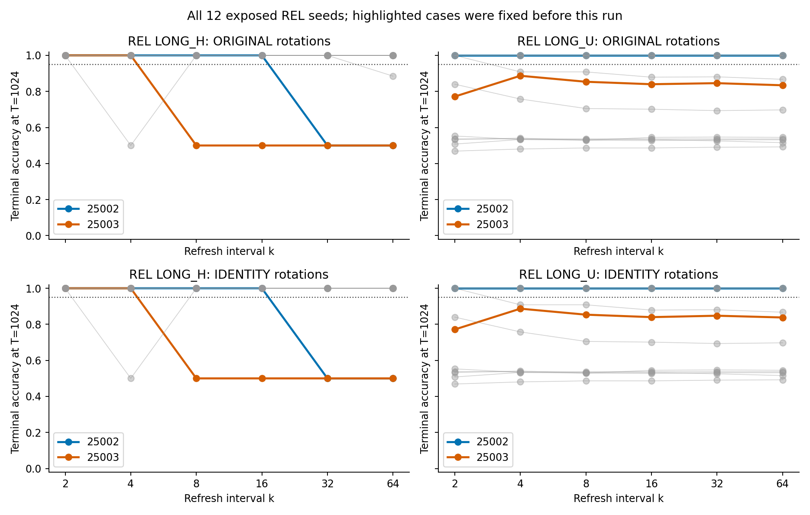
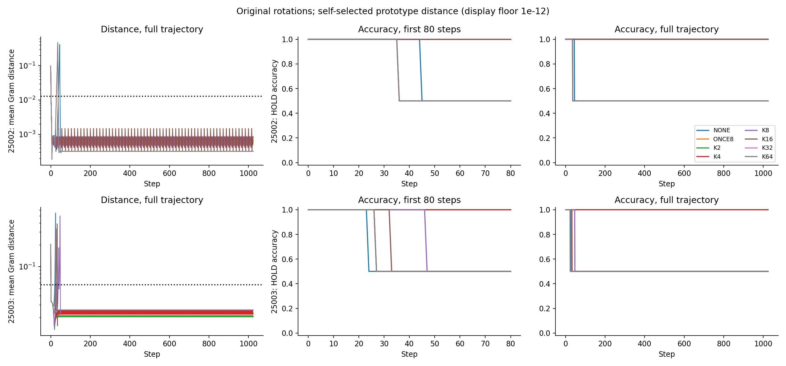
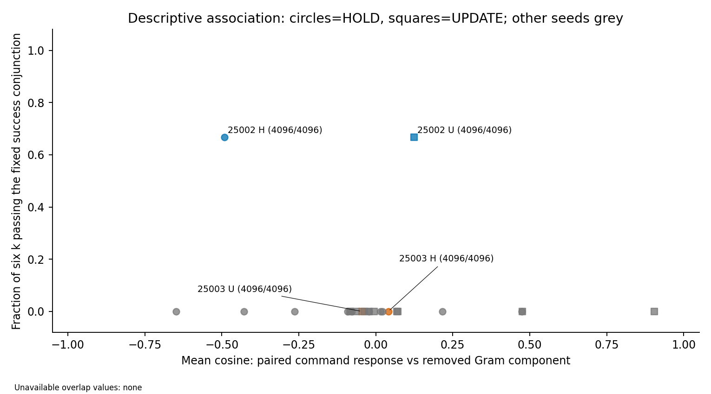

# EXP0026：重整间隔、旋转配对与漂移首越界

2026-09-29。协议v2，冻结源码007ccbb。登记判词 **PARTIALLY_SUPPORTED / SINGLE_EXPOSED_SCHEDULE_WINDOW**。本轮为DYN0002阶段A，对EXP0025的26个冻结模型作暴露轨迹机制诊断；原监督原型保持，无研究训练。

## 直接发现

25002出现一个离散、可重复到1024步的间隔窗口：EQUAL每2/4/8/16步刷新时，HOLD和UPDATE三个视界均100%；每32/64步时HOLD均50%。恒等旋转下同样成立，PHASE16仍成功、PHASE32仍失败。因此共同随机旋转并不是这个病例失效或窗口出现的必要条件；本轮没有把16–32之间的未测间隔命名为连续临界点，也没有建立跨seed定律。

25003的HOLD在k2/k4也能恢复到三个视界均100%，所以原来k8的失败并不等于它完全无法修复。困难出现在更新：T1024的UPDATE在k2为77.15%、k4为88.67%（NONE82.23%），没有达到同时保持与更新的95%门槛。三个主条件失败seed为25002、25003、25008；只有25002通过完整主窗口，旧参考23005单列。

次要触发对照也给出边界：25003 UPDATE的ADAPT90与COUNT90均尝试119491次、全部有效，但T1024分别62.50%和85.94%。调用次数本身不足以解释差异；这是特定状态触发规则与未来计数控制的对比，还不能定位任务写入子空间被擦除。25002 HOLD的两条件则均100%、均尝试13056次，少于K8的65536次；不据此提出执行效率或在线最优触发主张。

独立τ数据中25002/25003 HOLD的预定义lower median首越界滞后分别29/11；两者均有256/512序列右删失。UPDATE的τ则分别TAU_NOT_REACHED（512/512删失）和2（无删失）。它是特定自预测原型距离的首越界量，不能称慢模时间常数或用两个病例确认反比律。所有12个新INV在全部主条件三个视界均100%。

## 用户追问：为什么恰好50%？

这项只读核查是在结果产生后应用户疑问进行，不改变预注册终点。HOLD命令全部为0，目标逐时刻等于初始标签；每条流的真实0与1严格各256例。25002的NONE/ONCE8/K32在终点将512例全部预测为0：真实0全对，真实1全错，故256/512=50%；logit约−2.6314，远离判定阈值0。25003的NONE终点恰相反，512例全部预测为1，logit约+3.3483，也恰好50%。这不是随机猜测或零值舍入；只说明读出收敛到单类，尚不证明所有内部状态逐位合并。

25002真实1组在NONE中全部于t45首次出错，ONCE8中全部于t36首次出错。此前“第36步分叉”在这个病例实际是单次刷新更早出错，而非短期正确率提高。K16的两类512例则全程正确。K32从t8开始，下次刷新t40已经晚于t36的错误；该时间关系是本日程中的观测，不单独证明唯一阈值机制。原始逐类混淆矩阵和误差时间见`research/iterations/ITER-0021/half_accuracy_check.json`；独立复演也核对了这些标签/索引/预测。

## 主要窗口判定

ORIGINAL路径通过控制门并出现连续成功窗口的新REL种子：[25002]。控制不可判别种子：[]。

主窗口要求HOLD在256/512/1024步均≥95%、各视界相对NONE提升≥10pp，UPDATE同样均≥95%且每视界下降不超过2pp，EQUAL事件有效率H/U分别≥99%。失败分母同时要求EXP0025独立学习资格通过、本轮NONE的三个HOLD视界均低于95%；后一个条件使用了本轮已暴露数据，属于条件描述，不能声称新训练seed确认。

|seed|R路径|旧资格|条件失败|GAUGE控制|成功k|窗口|观测上界|
|---:|---|---|---|---|---|---|---|
|25001|ORIGINAL|True|False|True|[]|BASELINE_NOT_FAILURE|None|
|25001|IDENTITY|True|False|None|[]|BASELINE_NOT_FAILURE|None|
|25002|ORIGINAL|True|True|True|[2, 4, 8, 16]|PREFIX_WINDOW|16|
|25002|IDENTITY|True|True|None|[2, 4, 8, 16]|PREFIX_WINDOW|16|
|25003|ORIGINAL|True|True|True|[]|NO_WINDOW|None|
|25003|IDENTITY|True|True|None|[]|NO_WINDOW|None|
|25004|ORIGINAL|True|False|True|[]|BASELINE_NOT_FAILURE|None|
|25004|IDENTITY|True|False|None|[]|BASELINE_NOT_FAILURE|None|
|25005|ORIGINAL|False|False|True|[]|BASELINE_NOT_FAILURE|None|
|25005|IDENTITY|False|False|None|[]|BASELINE_NOT_FAILURE|None|
|25006|ORIGINAL|False|False|True|[]|BASELINE_NOT_FAILURE|None|
|25006|IDENTITY|False|False|None|[]|BASELINE_NOT_FAILURE|None|
|25007|ORIGINAL|False|False|True|[]|BASELINE_NOT_FAILURE|None|
|25007|IDENTITY|False|False|None|[]|BASELINE_NOT_FAILURE|None|
|25008|ORIGINAL|True|True|True|[]|NO_WINDOW|None|
|25008|IDENTITY|True|True|None|[]|NO_WINDOW|None|
|25009|ORIGINAL|True|False|True|[]|BASELINE_NOT_FAILURE|None|
|25009|IDENTITY|True|False|None|[]|BASELINE_NOT_FAILURE|None|
|25010|ORIGINAL|True|False|True|[]|BASELINE_NOT_FAILURE|None|
|25010|IDENTITY|True|False|None|[]|BASELINE_NOT_FAILURE|None|
|25011|ORIGINAL|True|False|True|[]|BASELINE_NOT_FAILURE|None|
|25011|IDENTITY|True|False|None|[]|BASELINE_NOT_FAILURE|None|
|25012|ORIGINAL|True|False|True|[]|BASELINE_NOT_FAILURE|None|
|25012|IDENTITY|True|False|None|[]|BASELINE_NOT_FAILURE|None|

连续后缀成功但延伸到64的窗口右端未测；非单调集合不强行命名临界间隔。IDENTITY缺单独GAUGE门，仅作配对描述；旧参考23005不进新seed分母。

## 预设病例的三个视界

|seed|任务|R|条件|256|512|1024|有效/尝试|
|---:|---|---|---|---:|---:|---:|---|
|25002|LONG_H|ORIGINAL|NONE|50.00%|50.00%|50.00%|0/0|
|25002|LONG_H|ORIGINAL|ONCE8|50.00%|50.00%|50.00%|512/512|
|25002|LONG_H|ORIGINAL|K2|100.00%|100.00%|100.00%|260608/260608|
|25002|LONG_H|ORIGINAL|K4|100.00%|100.00%|100.00%|130560/130560|
|25002|LONG_H|ORIGINAL|K8|100.00%|100.00%|100.00%|65536/65536|
|25002|LONG_H|ORIGINAL|K16|100.00%|100.00%|100.00%|32768/32768|
|25002|LONG_H|ORIGINAL|K32|50.00%|50.00%|50.00%|16384/16384|
|25002|LONG_H|ORIGINAL|K64|50.00%|50.00%|50.00%|8192/8192|
|25002|LONG_H|ORIGINAL|PHASE16|100.00%|100.00%|100.00%|32768/32768|
|25002|LONG_H|ORIGINAL|PHASE32|50.00%|50.00%|50.00%|16384/16384|
|25002|LONG_H|ORIGINAL|FULL8|100.00%|100.00%|100.00%|65536/65536|
|25002|LONG_H|ORIGINAL|SCALE8|50.00%|50.00%|50.00%|65536/65536|
|25002|LONG_H|ORIGINAL|GAUGE8|50.00%|50.00%|50.00%|65536/65536|
|25002|LONG_H|ORIGINAL|ADAPT90|100.00%|100.00%|100.00%|13056/13056|
|25002|LONG_H|ORIGINAL|COUNT90|100.00%|100.00%|100.00%|13056/13056|
|25002|LONG_H|IDENTITY|NONE|50.00%|50.00%|50.00%|0/0|
|25002|LONG_H|IDENTITY|ONCE8|50.00%|50.00%|50.00%|512/512|
|25002|LONG_H|IDENTITY|K2|100.00%|100.00%|100.00%|260608/260608|
|25002|LONG_H|IDENTITY|K4|100.00%|100.00%|100.00%|130560/130560|
|25002|LONG_H|IDENTITY|K8|100.00%|100.00%|100.00%|65536/65536|
|25002|LONG_H|IDENTITY|K16|100.00%|100.00%|100.00%|32768/32768|
|25002|LONG_H|IDENTITY|K32|50.00%|50.00%|50.00%|16384/16384|
|25002|LONG_H|IDENTITY|K64|50.00%|50.00%|50.00%|8192/8192|
|25002|LONG_U|ORIGINAL|NONE|100.00%|100.00%|100.00%|0/0|
|25002|LONG_U|ORIGINAL|ONCE8|100.00%|100.00%|100.00%|512/512|
|25002|LONG_U|ORIGINAL|K2|100.00%|100.00%|100.00%|260608/260608|
|25002|LONG_U|ORIGINAL|K4|100.00%|100.00%|100.00%|130560/130560|
|25002|LONG_U|ORIGINAL|K8|100.00%|100.00%|100.00%|65536/65536|
|25002|LONG_U|ORIGINAL|K16|100.00%|100.00%|100.00%|32768/32768|
|25002|LONG_U|ORIGINAL|K32|100.00%|100.00%|100.00%|16384/16384|
|25002|LONG_U|ORIGINAL|K64|100.00%|100.00%|100.00%|8192/8192|
|25002|LONG_U|ORIGINAL|PHASE16|100.00%|100.00%|100.00%|32768/32768|
|25002|LONG_U|ORIGINAL|PHASE32|100.00%|100.00%|100.00%|16384/16384|
|25002|LONG_U|ORIGINAL|FULL8|100.00%|100.00%|100.00%|65536/65536|
|25002|LONG_U|ORIGINAL|SCALE8|100.00%|100.00%|100.00%|65536/65536|
|25002|LONG_U|ORIGINAL|GAUGE8|100.00%|100.00%|100.00%|65536/65536|
|25002|LONG_U|ORIGINAL|ADAPT90|100.00%|100.00%|100.00%|0/0|
|25002|LONG_U|ORIGINAL|COUNT90|100.00%|100.00%|100.00%|0/0|
|25002|LONG_U|IDENTITY|NONE|100.00%|100.00%|100.00%|0/0|
|25002|LONG_U|IDENTITY|ONCE8|100.00%|100.00%|100.00%|512/512|
|25002|LONG_U|IDENTITY|K2|100.00%|100.00%|100.00%|260608/260608|
|25002|LONG_U|IDENTITY|K4|100.00%|100.00%|100.00%|130560/130560|
|25002|LONG_U|IDENTITY|K8|100.00%|100.00%|100.00%|65536/65536|
|25002|LONG_U|IDENTITY|K16|100.00%|100.00%|100.00%|32768/32768|
|25002|LONG_U|IDENTITY|K32|100.00%|100.00%|100.00%|16384/16384|
|25002|LONG_U|IDENTITY|K64|100.00%|100.00%|100.00%|8192/8192|
|25003|LONG_H|ORIGINAL|NONE|50.00%|50.00%|50.00%|0/0|
|25003|LONG_H|ORIGINAL|ONCE8|50.00%|50.00%|50.00%|512/512|
|25003|LONG_H|ORIGINAL|K2|100.00%|100.00%|100.00%|260608/260608|
|25003|LONG_H|ORIGINAL|K4|100.00%|100.00%|100.00%|130560/130560|
|25003|LONG_H|ORIGINAL|K8|50.00%|50.00%|50.00%|65536/65536|
|25003|LONG_H|ORIGINAL|K16|50.00%|50.00%|50.00%|32768/32768|
|25003|LONG_H|ORIGINAL|K32|50.00%|50.00%|50.00%|16384/16384|
|25003|LONG_H|ORIGINAL|K64|50.00%|50.00%|50.00%|8192/8192|
|25003|LONG_H|ORIGINAL|PHASE16|50.00%|50.00%|50.00%|32768/32768|
|25003|LONG_H|ORIGINAL|PHASE32|50.00%|50.00%|50.00%|16384/16384|
|25003|LONG_H|ORIGINAL|FULL8|100.00%|100.00%|100.00%|65536/65536|
|25003|LONG_H|ORIGINAL|SCALE8|50.00%|50.00%|50.00%|65536/65536|
|25003|LONG_H|ORIGINAL|GAUGE8|50.00%|50.00%|50.00%|65536/65536|
|25003|LONG_H|ORIGINAL|ADAPT90|100.00%|100.00%|100.00%|45824/45824|
|25003|LONG_H|ORIGINAL|COUNT90|100.00%|100.00%|100.00%|45824/45824|
|25003|LONG_H|IDENTITY|NONE|50.00%|50.00%|50.00%|0/0|
|25003|LONG_H|IDENTITY|ONCE8|50.00%|50.00%|50.00%|512/512|
|25003|LONG_H|IDENTITY|K2|100.00%|100.00%|100.00%|260608/260608|
|25003|LONG_H|IDENTITY|K4|100.00%|100.00%|100.00%|130560/130560|
|25003|LONG_H|IDENTITY|K8|50.00%|50.00%|50.00%|65536/65536|
|25003|LONG_H|IDENTITY|K16|50.00%|50.00%|50.00%|32768/32768|
|25003|LONG_H|IDENTITY|K32|50.00%|50.00%|50.00%|16384/16384|
|25003|LONG_H|IDENTITY|K64|50.00%|50.00%|50.00%|8192/8192|
|25003|LONG_U|ORIGINAL|NONE|96.09%|92.38%|82.23%|0/0|
|25003|LONG_U|ORIGINAL|ONCE8|95.70%|92.19%|82.03%|512/512|
|25003|LONG_U|ORIGINAL|K2|93.36%|88.67%|77.15%|260608/260608|
|25003|LONG_U|ORIGINAL|K4|96.09%|93.36%|88.67%|130560/130560|
|25003|LONG_U|ORIGINAL|K8|95.90%|91.60%|85.35%|65536/65536|
|25003|LONG_U|ORIGINAL|K16|97.07%|93.36%|83.98%|32768/32768|
|25003|LONG_U|ORIGINAL|K32|96.48%|92.77%|84.57%|16384/16384|
|25003|LONG_U|ORIGINAL|K64|95.90%|92.19%|83.40%|8192/8192|
|25003|LONG_U|ORIGINAL|PHASE16|96.09%|91.80%|84.77%|32768/32768|
|25003|LONG_U|ORIGINAL|PHASE32|96.09%|92.38%|85.55%|16384/16384|
|25003|LONG_U|ORIGINAL|FULL8|72.07%|57.62%|50.39%|65536/65536|
|25003|LONG_U|ORIGINAL|SCALE8|54.10%|51.76%|50.20%|65410/65536|
|25003|LONG_U|ORIGINAL|GAUGE8|96.09%|92.58%|82.42%|65536/65536|
|25003|LONG_U|ORIGINAL|ADAPT90|86.13%|77.15%|62.50%|119491/119491|
|25003|LONG_U|ORIGINAL|COUNT90|95.70%|92.97%|85.94%|119491/119491|
|25003|LONG_U|IDENTITY|NONE|95.90%|92.19%|82.03%|0/0|
|25003|LONG_U|IDENTITY|ONCE8|95.90%|92.19%|82.42%|512/512|
|25003|LONG_U|IDENTITY|K2|93.36%|88.67%|77.15%|260608/260608|
|25003|LONG_U|IDENTITY|K4|96.09%|93.36%|88.67%|130560/130560|
|25003|LONG_U|IDENTITY|K8|95.90%|91.60%|85.35%|65536/65536|
|25003|LONG_U|IDENTITY|K16|97.07%|93.36%|83.98%|32768/32768|
|25003|LONG_U|IDENTITY|K32|96.48%|92.77%|84.77%|16384/16384|
|25003|LONG_U|IDENTITY|K64|95.90%|92.38%|83.79%|8192/8192|
|23005|LONG_H|ORIGINAL|NONE|50.00%|50.00%|50.00%|0/0|
|23005|LONG_H|ORIGINAL|ONCE8|50.00%|50.00%|50.00%|512/512|
|23005|LONG_H|ORIGINAL|K2|100.00%|100.00%|100.00%|260608/260608|
|23005|LONG_H|ORIGINAL|K4|100.00%|100.00%|100.00%|130560/130560|
|23005|LONG_H|ORIGINAL|K8|100.00%|100.00%|100.00%|65536/65536|
|23005|LONG_H|ORIGINAL|K16|50.00%|50.00%|50.00%|32768/32768|
|23005|LONG_H|ORIGINAL|K32|50.00%|50.00%|50.00%|16384/16384|
|23005|LONG_H|ORIGINAL|K64|50.00%|50.00%|50.00%|8192/8192|
|23005|LONG_H|ORIGINAL|PHASE16|50.00%|50.00%|50.00%|32768/32768|
|23005|LONG_H|ORIGINAL|PHASE32|50.00%|50.00%|50.00%|16384/16384|
|23005|LONG_H|ORIGINAL|FULL8|100.00%|100.00%|100.00%|65536/65536|
|23005|LONG_H|ORIGINAL|SCALE8|50.00%|50.00%|50.00%|65536/65536|
|23005|LONG_H|ORIGINAL|GAUGE8|50.00%|50.00%|50.00%|65536/65536|
|23005|LONG_H|ORIGINAL|ADAPT90|100.00%|100.00%|100.00%|25856/25856|
|23005|LONG_H|ORIGINAL|COUNT90|100.00%|100.00%|100.00%|25856/25856|
|23005|LONG_H|IDENTITY|NONE|50.00%|50.00%|50.00%|0/0|
|23005|LONG_H|IDENTITY|ONCE8|50.00%|50.00%|50.00%|512/512|
|23005|LONG_H|IDENTITY|K2|100.00%|100.00%|100.00%|260608/260608|
|23005|LONG_H|IDENTITY|K4|100.00%|100.00%|100.00%|130560/130560|
|23005|LONG_H|IDENTITY|K8|100.00%|100.00%|100.00%|65536/65536|
|23005|LONG_H|IDENTITY|K16|50.00%|50.00%|50.00%|32768/32768|
|23005|LONG_H|IDENTITY|K32|50.00%|50.00%|50.00%|16384/16384|
|23005|LONG_H|IDENTITY|K64|50.00%|50.00%|50.00%|8192/8192|
|23005|LONG_U|ORIGINAL|NONE|100.00%|100.00%|100.00%|0/0|
|23005|LONG_U|ORIGINAL|ONCE8|98.63%|98.63%|98.63%|512/512|
|23005|LONG_U|ORIGINAL|K2|100.00%|100.00%|100.00%|260608/260608|
|23005|LONG_U|ORIGINAL|K4|100.00%|100.00%|100.00%|130560/130560|
|23005|LONG_U|ORIGINAL|K8|100.00%|100.00%|100.00%|65536/65536|
|23005|LONG_U|ORIGINAL|K16|97.85%|96.09%|93.16%|32768/32768|
|23005|LONG_U|ORIGINAL|K32|94.53%|91.02%|85.55%|16384/16384|
|23005|LONG_U|ORIGINAL|K64|95.70%|95.12%|91.99%|8191/8192|
|23005|LONG_U|ORIGINAL|PHASE16|98.83%|98.24%|95.51%|32767/32768|
|23005|LONG_U|ORIGINAL|PHASE32|97.27%|91.41%|83.01%|16383/16384|
|23005|LONG_U|ORIGINAL|FULL8|100.00%|100.00%|100.00%|65536/65536|
|23005|LONG_U|ORIGINAL|SCALE8|100.00%|100.00%|100.00%|65536/65536|
|23005|LONG_U|ORIGINAL|GAUGE8|100.00%|100.00%|100.00%|65536/65536|
|23005|LONG_U|ORIGINAL|ADAPT90|100.00%|100.00%|100.00%|66305/66305|
|23005|LONG_U|ORIGINAL|COUNT90|100.00%|100.00%|100.00%|66305/66305|
|23005|LONG_U|IDENTITY|NONE|100.00%|100.00%|100.00%|0/0|
|23005|LONG_U|IDENTITY|ONCE8|98.63%|98.63%|98.63%|512/512|
|23005|LONG_U|IDENTITY|K2|100.00%|100.00%|100.00%|260608/260608|
|23005|LONG_U|IDENTITY|K4|100.00%|100.00%|100.00%|130560/130560|
|23005|LONG_U|IDENTITY|K8|100.00%|100.00%|100.00%|65536/65536|
|23005|LONG_U|IDENTITY|K16|97.85%|96.09%|93.16%|32768/32768|
|23005|LONG_U|IDENTITY|K32|94.53%|91.02%|85.55%|16384/16384|
|23005|LONG_U|IDENTITY|K64|95.70%|95.12%|91.99%|8191/8192|

## 原旋转与恒等旋转

|seed|模型|任务|最大Gram距离|平均Gram距离|1024准确率差R−I|
|---:|---|---|---:|---:|---:|
|25001|REL|LONG_H|0.756612|0.0967766|+0.0000%|
|25001|REL|LONG_U|0.0180228|1.38797e-06|+0.0000%|
|25001|INV|LONG_H|5.65459e-07|9.02391e-08|+0.0000%|
|25001|INV|LONG_U|7.12768e-07|5.37101e-08|+0.0000%|
|25002|REL|LONG_H|0.0146837|4.42562e-06|+0.0000%|
|25002|REL|LONG_U|2.61582e-06|2.98043e-07|+0.0000%|
|25002|INV|LONG_H|4.65527e-07|5.72774e-08|+0.0000%|
|25002|INV|LONG_U|1.2742e-06|1.57395e-07|+0.0000%|
|25003|REL|LONG_H|3.50811e-05|1.50969e-07|+0.0000%|
|25003|REL|LONG_U|1.99663|0.00751547|+0.1953%|
|25003|INV|LONG_H|5.39743e-07|3.81798e-08|+0.0000%|
|25003|INV|LONG_U|5.16191e-07|4.1074e-08|+0.0000%|
|25004|REL|LONG_H|6.63729e-07|9.40238e-08|+0.0000%|
|25004|REL|LONG_U|0.137581|1.45471e-06|+0.0000%|
|25004|INV|LONG_H|5.68592e-07|9.14024e-08|+0.0000%|
|25004|INV|LONG_U|6.97654e-07|5.50424e-08|+0.0000%|
|25005|REL|LONG_H|7.15256e-07|1.07553e-07|+0.0000%|
|25005|REL|LONG_U|2.18076|0.000299152|+0.0000%|
|25005|INV|LONG_H|4.08629e-07|8.71928e-08|+0.0000%|
|25005|INV|LONG_U|4.08629e-07|2.75971e-08|+0.0000%|
|25006|REL|LONG_H|3.82708e-05|1.9867e-07|+0.0000%|
|25006|REL|LONG_U|8.38712e-07|1.89678e-07|+0.0000%|
|25006|INV|LONG_H|4.21468e-07|3.30181e-08|+0.0000%|
|25006|INV|LONG_U|7.46844e-07|4.01731e-08|+0.0000%|
|25007|REL|LONG_H|5.55955e-07|8.00202e-08|+0.0000%|
|25007|REL|LONG_U|5.23672e-06|1.84945e-07|+0.0000%|
|25007|INV|LONG_H|5.23029e-07|4.00791e-08|+0.0000%|
|25007|INV|LONG_U|6.33606e-07|3.83011e-08|+0.0000%|
|25008|REL|LONG_H|0.00260741|1.3562e-06|+0.0000%|
|25008|REL|LONG_U|0.0187351|3.62496e-07|+0.0000%|
|25008|INV|LONG_H|5.09262e-07|8.78032e-08|+0.0000%|
|25008|INV|LONG_U|5.09262e-07|3.90099e-08|+0.0000%|
|25009|REL|LONG_H|7.17735e-07|9.94642e-08|+0.0000%|
|25009|REL|LONG_U|0.655062|6.03156e-06|+0.0000%|
|25009|INV|LONG_H|3.90854e-07|7.0154e-08|+0.0000%|
|25009|INV|LONG_U|5.59141e-07|3.89872e-08|+0.0000%|
|25010|REL|LONG_H|1.02559e-06|1.89186e-07|+0.0000%|
|25010|REL|LONG_U|2.41196e-06|2.81034e-07|+0.0000%|
|25010|INV|LONG_H|4.65527e-07|7.86217e-08|+0.0000%|
|25010|INV|LONG_U|6.44723e-07|4.92668e-08|+0.0000%|
|25011|REL|LONG_H|9.5414e-07|2.18071e-07|+0.0000%|
|25011|REL|LONG_U|3.3608e-06|3.12097e-07|+0.0000%|
|25011|INV|LONG_H|6.04921e-07|1.0721e-07|+0.0000%|
|25011|INV|LONG_U|5.39743e-07|6.25386e-08|+0.0000%|
|25012|REL|LONG_H|1.72545e-06|2.93431e-07|+0.0000%|
|25012|REL|LONG_U|2.66976e-06|3.31192e-07|+0.0000%|
|25012|INV|LONG_H|1.07784e-06|2.144e-07|+0.0000%|
|25012|INV|LONG_U|1.83327e-06|2.16758e-07|+0.0000%|
|23005|REL|LONG_H|0.0228552|1.3961e-05|+0.0000%|
|23005|REL|LONG_U|0.06985|1.14683e-06|+0.0000%|
|23005|INV|LONG_H|7.98012e-07|1.30821e-07|+0.0000%|
|23005|INV|LONG_U|1.07454e-06|1.80104e-07|+0.0000%|

这是同命令但经历不同历史旋转的轨迹差。理想共同R对Gram为gauge，所测差异可能包含数值误差的动态放大；不能把历史分叉向量直接称同一状态的纯干扰子空间。

## 独立漂移τ

|seed|模型|任务|R|首越界lower median|未越界/512|预测类别切换率|
|---:|---|---|---|---|---:|---:|
|25001|REL|LONG_H|ORIGINAL|8|256/512|0.0000%|
|25001|REL|LONG_H|IDENTITY|8|256/512|0.0000%|
|25001|REL|LONG_U|ORIGINAL|3|0/512|49.9945%|
|25001|REL|LONG_U|IDENTITY|3|0/512|49.9945%|
|25001|INV|LONG_H|ORIGINAL|TAU_NOT_REACHED|512/512|0.0000%|
|25001|INV|LONG_H|IDENTITY|TAU_NOT_REACHED|512/512|0.0000%|
|25001|INV|LONG_U|ORIGINAL|3|0/512|50.0397%|
|25001|INV|LONG_U|IDENTITY|3|0/512|50.0397%|
|25002|REL|LONG_H|ORIGINAL|29|256/512|0.0488%|
|25002|REL|LONG_H|IDENTITY|29|256/512|0.0488%|
|25002|REL|LONG_U|ORIGINAL|TAU_NOT_REACHED|512/512|50.1011%|
|25002|REL|LONG_U|IDENTITY|TAU_NOT_REACHED|512/512|50.1011%|
|25002|INV|LONG_H|ORIGINAL|TAU_NOT_REACHED|512/512|0.0000%|
|25002|INV|LONG_H|IDENTITY|TAU_NOT_REACHED|512/512|0.0000%|
|25002|INV|LONG_U|ORIGINAL|13|0/512|50.1011%|
|25002|INV|LONG_U|IDENTITY|15|0/512|50.1011%|
|25003|REL|LONG_H|ORIGINAL|11|256/512|0.0488%|
|25003|REL|LONG_H|IDENTITY|11|256/512|0.0488%|
|25003|REL|LONG_U|ORIGINAL|2|0/512|49.8295%|
|25003|REL|LONG_U|IDENTITY|2|0/512|49.8281%|
|25003|INV|LONG_H|ORIGINAL|TAU_NOT_REACHED|512/512|0.0000%|
|25003|INV|LONG_H|IDENTITY|TAU_NOT_REACHED|512/512|0.0000%|
|25003|INV|LONG_U|ORIGINAL|4|0/512|50.0456%|
|25003|INV|LONG_U|IDENTITY|4|0/512|50.0456%|
|25004|REL|LONG_H|ORIGINAL|TAU_NOT_REACHED|512/512|0.0000%|
|25004|REL|LONG_H|IDENTITY|TAU_NOT_REACHED|512/512|0.0000%|
|25004|REL|LONG_U|ORIGINAL|6|0/512|50.0925%|
|25004|REL|LONG_U|IDENTITY|6|0/512|50.0925%|
|25004|INV|LONG_H|ORIGINAL|TAU_NOT_REACHED|512/512|0.0000%|
|25004|INV|LONG_H|IDENTITY|TAU_NOT_REACHED|512/512|0.0000%|
|25004|INV|LONG_U|ORIGINAL|3|0/512|50.0053%|
|25004|INV|LONG_U|IDENTITY|2|0/512|50.0053%|
|25005|REL|LONG_H|ORIGINAL|TAU_NOT_REACHED|512/512|0.0000%|
|25005|REL|LONG_H|IDENTITY|TAU_NOT_REACHED|512/512|0.0000%|
|25005|REL|LONG_U|ORIGINAL|3|0/512|27.5322%|
|25005|REL|LONG_U|IDENTITY|3|0/512|27.5316%|
|25005|INV|LONG_H|ORIGINAL|TAU_NOT_REACHED|512/512|0.0000%|
|25005|INV|LONG_H|IDENTITY|TAU_NOT_REACHED|512/512|0.0000%|
|25005|INV|LONG_U|ORIGINAL|2|0/512|50.0698%|
|25005|INV|LONG_U|IDENTITY|3|0/512|50.0698%|
|25006|REL|LONG_H|ORIGINAL|TAU_NOT_REACHED|512/512|0.0000%|
|25006|REL|LONG_H|IDENTITY|TAU_NOT_REACHED|512/512|0.0000%|
|25006|REL|LONG_U|ORIGINAL|TAU_NOT_REACHED|512/512|0.1465%|
|25006|REL|LONG_U|IDENTITY|TAU_NOT_REACHED|512/512|0.1465%|
|25006|INV|LONG_H|ORIGINAL|TAU_NOT_REACHED|512/512|0.0000%|
|25006|INV|LONG_H|IDENTITY|TAU_NOT_REACHED|512/512|0.0000%|
|25006|INV|LONG_U|ORIGINAL|4|0/512|50.0643%|
|25006|INV|LONG_U|IDENTITY|4|0/512|50.0643%|
|25007|REL|LONG_H|ORIGINAL|0|256/512|0.0000%|
|25007|REL|LONG_H|IDENTITY|0|256/512|0.0000%|
|25007|REL|LONG_U|ORIGINAL|TAU_NOT_REACHED|512/512|0.1465%|
|25007|REL|LONG_U|IDENTITY|TAU_NOT_REACHED|512/512|0.1465%|
|25007|INV|LONG_H|ORIGINAL|TAU_NOT_REACHED|512/512|0.0000%|
|25007|INV|LONG_H|IDENTITY|TAU_NOT_REACHED|512/512|0.0000%|
|25007|INV|LONG_U|ORIGINAL|3|0/512|49.9365%|
|25007|INV|LONG_U|IDENTITY|3|0/512|49.9365%|
|25008|REL|LONG_H|ORIGINAL|170|256/512|0.0488%|
|25008|REL|LONG_H|IDENTITY|170|256/512|0.0488%|
|25008|REL|LONG_U|ORIGINAL|9|0/512|50.1854%|
|25008|REL|LONG_U|IDENTITY|9|0/512|50.1854%|
|25008|INV|LONG_H|ORIGINAL|TAU_NOT_REACHED|512/512|0.0000%|
|25008|INV|LONG_H|IDENTITY|TAU_NOT_REACHED|512/512|0.0000%|
|25008|INV|LONG_U|ORIGINAL|4|0/512|50.1738%|
|25008|INV|LONG_U|IDENTITY|5|0/512|50.1738%|
|25009|REL|LONG_H|ORIGINAL|TAU_NOT_REACHED|512/512|0.0000%|
|25009|REL|LONG_H|IDENTITY|TAU_NOT_REACHED|512/512|0.0000%|
|25009|REL|LONG_U|ORIGINAL|6|0/512|49.9584%|
|25009|REL|LONG_U|IDENTITY|6|0/512|49.9584%|
|25009|INV|LONG_H|ORIGINAL|TAU_NOT_REACHED|512/512|0.0000%|
|25009|INV|LONG_H|IDENTITY|TAU_NOT_REACHED|512/512|0.0000%|
|25009|INV|LONG_U|ORIGINAL|3|0/512|50.0378%|
|25009|INV|LONG_U|IDENTITY|4|0/512|50.0378%|
|25010|REL|LONG_H|ORIGINAL|TAU_NOT_REACHED|512/512|0.0000%|
|25010|REL|LONG_H|IDENTITY|TAU_NOT_REACHED|512/512|0.0000%|
|25010|REL|LONG_U|ORIGINAL|TAU_NOT_REACHED|512/512|50.0401%|
|25010|REL|LONG_U|IDENTITY|TAU_NOT_REACHED|512/512|50.0401%|
|25010|INV|LONG_H|ORIGINAL|TAU_NOT_REACHED|512/512|0.0000%|
|25010|INV|LONG_H|IDENTITY|TAU_NOT_REACHED|512/512|0.0000%|
|25010|INV|LONG_U|ORIGINAL|2|0/512|50.0401%|
|25010|INV|LONG_U|IDENTITY|2|0/512|50.0401%|
|25011|REL|LONG_H|ORIGINAL|TAU_NOT_REACHED|512/512|0.0000%|
|25011|REL|LONG_H|IDENTITY|TAU_NOT_REACHED|512/512|0.0000%|
|25011|REL|LONG_U|ORIGINAL|TAU_NOT_REACHED|512/512|50.0076%|
|25011|REL|LONG_U|IDENTITY|TAU_NOT_REACHED|512/512|50.0076%|
|25011|INV|LONG_H|ORIGINAL|TAU_NOT_REACHED|512/512|0.0000%|
|25011|INV|LONG_H|IDENTITY|TAU_NOT_REACHED|512/512|0.0000%|
|25011|INV|LONG_U|ORIGINAL|4|0/512|50.0076%|
|25011|INV|LONG_U|IDENTITY|4|0/512|50.0076%|
|25012|REL|LONG_H|ORIGINAL|TAU_NOT_REACHED|512/512|0.0000%|
|25012|REL|LONG_H|IDENTITY|TAU_NOT_REACHED|512/512|0.0000%|
|25012|REL|LONG_U|ORIGINAL|3|0/512|50.0879%|
|25012|REL|LONG_U|IDENTITY|3|0/512|50.0879%|
|25012|INV|LONG_H|ORIGINAL|TAU_NOT_REACHED|512/512|0.0000%|
|25012|INV|LONG_H|IDENTITY|TAU_NOT_REACHED|512/512|0.0000%|
|25012|INV|LONG_U|ORIGINAL|10|0/512|50.0879%|
|25012|INV|LONG_U|IDENTITY|10|0/512|50.0879%|
|23005|REL|LONG_H|ORIGINAL|13|256/512|0.0488%|
|23005|REL|LONG_H|IDENTITY|13|256/512|0.0488%|
|23005|REL|LONG_U|ORIGINAL|3|0/512|50.1299%|
|23005|REL|LONG_U|IDENTITY|3|0/512|50.1299%|
|23005|INV|LONG_H|ORIGINAL|TAU_NOT_REACHED|512/512|0.0000%|
|23005|INV|LONG_H|IDENTITY|TAU_NOT_REACHED|512/512|0.0000%|
|23005|INV|LONG_U|ORIGINAL|TAU_NOT_REACHED|512/512|50.1293%|
|23005|INV|LONG_U|IDENTITY|TAU_NOT_REACHED|512/512|50.1293%|

τ为独立NONE输入中，从t8起到自身预测类原型的Gram距离首次严格超过校准q90的滞后。它不是Jacobian模态衰减常数，不能直接拟合周期反比定律；预测类切换也可能使距离突变。未越界样本保留删失，未对已越界者单算中位数。

## 次要机制对照与解释边界

PHASE16/32改变首次刷新相位；FULL/SCALE/GAUGE分别保留原型、幅度与坐标控制。ADAPT90用pre距离和两步冷却，失败尝试也收费。COUNT90使用同一例ADAPT的完整T1024尝试总数排均匀时间表，具有未来调用数信息，是事后匹配对照；只在T1024比较调用次数匹配后的结果，短视界不可声称计数匹配。

命令诊断从同一个状态分别执行HOLD/FLIP；刷新删除方向取当前Gram减EQUAL后Gram，正余弦表示方向重叠。重整无效或必要向量范数<1e−6时余弦不可用，不填0。该关联尚不能证明任务信息被擦除；没有进行命令子空间保护干预。全部104条几何摘要、近零分母和12seed描述性效果在geometry_summary.json/descriptive_effects.json。

本轮没有把方向命名为快变量/慢变量，没有吸引盆识别或因果子空间消融，也没有新训练seed。监督二状态codebook是强替代解释；显式XOR状态机用一个bit即可精确解题，理想oracle100%。阶段B需由本轮可测规律另冻结，当前Gate1仍NOT_PASSED。

## 图与证据

实际完成1196主rollout+104独立τrollout，基础转移681,574,400，命令反事实851,968，额外诊断EQUAL提议425,984。刷新尝试69,366,266、有效67,590,467。研究优化0、原型拟合0。运行1055.68秒，分析103.85秒，共享预算3600秒。

323项工程测试通过；专项工程根269026，神经研究模型未用于阈值/门槛调整。CPU1 float32，参数REL340/INV406、动态状态24bytes、原型48bytes每模型；FLOPs/峰值内存未测，无效率主张。完整逐rollout wall/CPU/有效率见resource_disclosure.json。独立原始指标复核与预定子集复演、packet反思、APFS/项目哈希归档分别见ITER0021与research/reflections/ITER-0021。

独立结果复核PASS：1300/1300原始rollout审计、200/200预定子集逐数组精确复演，单次185.10秒≤600秒；主判词、138个效应单元、52个R/I配对与104个命令几何摘要独立重算一致。共享模型转移/Gram/生成器，日程、刷新编排及指标独立实现。

反思补证：精确再生成的200条属于四个事前固定模型(25002,REL)、(25003,REL)、(25010,REL)、(25002,INV)，每模型46主轨迹+4τ。逐数组精确匹配字段为logits、distance_pre/post、event_i/t/reason、event_pre/post_z、event_pre/post_g；其余遥测和命令几何从已存raw独立核算。全部1300条均做raw审计，不表示1300条都重新前向。200个唯一行键及运行前提交证据见ITER0021/replay_scope_clarification.json。
