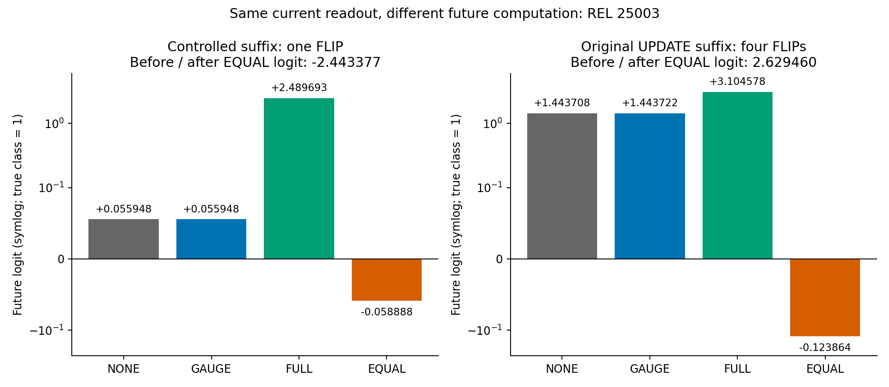
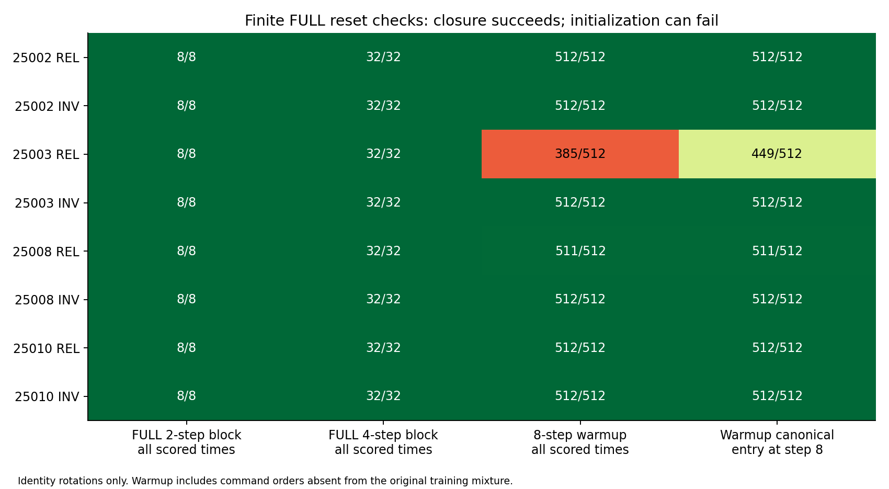
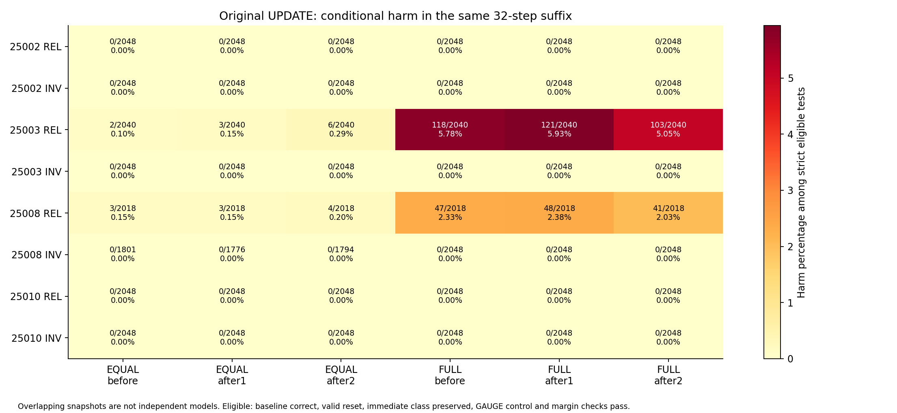

# EXP0027：重整保留当前读出，却可能损害后续计算

2026-09-29。EXP0027v2，冻结源68200dc。结果 **SUPPORTED / EXPOSED_STATE_COMPUTATION_INCOMPATIBILITY**，仅指已暴露冻结状态的受控反例；没有新训练seed或新架构。实验主线已转为状态功能兼容性，相位作为次要混杂检查。

## 核心反例

在25003 REL中找到保持当前标量logit、通过同时间GAUGE控制后，下一次合法命令执行出错的具体状态。受控微任务的最短已见后缀只含一条FLIP；真实已保存UPDATE流中的最短已见EQUAL后缀反例包含四条FLIP。二者的对照分支在整个预定后缀均正确，干预即时类别保持正确，误差满足预先固定1e−4裕度要求。

|来源|操作|重整前logit|重整后当前logit|后缀末logit（真值1）|结果|
|---|---|---:|---:|---:|---|
|受控1次FLIP|NONE|-2.443377|-2.443377|+0.055948|正确|
|受控1次FLIP|GAUGE|-2.443377|-2.443377|+0.055948|正确|
|受控1次FLIP|FULL|-2.443377|-2.391520|+2.489693|正确|
|受控1次FLIP|EQUAL|-2.443377|-2.443377|-0.058888|错误|
|真实4次FLIP|NONE|+2.629460|+2.629460|+1.443708|正确|
|真实4次FLIP|GAUGE|+2.629460|+2.629459|+1.443722|正确|
|真实4次FLIP|FULL|+2.629460|+3.275382|+3.104578|正确|
|真实4次FLIP|EQUAL|+2.629460|+2.629460|-0.123864|错误|

受控反例从原HOLD输入t8的完整H开始，再执行两条HOLD，在t10施加EQUAL，t11的FLIP失败。它是合法命令微任务，但改变了原纯HOLD的后续命令分布；因此另用原UPDATE后续32步验证，不能只用这条微任务声称原分布失效。真实反例来自UPDATE样本索引14（从0计）、anchor8、after2分支：当前真值1且logit保持+2.629460，接原流中的四次FLIP，对照+1.443708正确、EQUAL−0.123864错误。完整H、输入、评分、GAUGE控制与标签在key_findings.json及raw。受控反例在那次FLIP错误后，下一条HOLD又读对了；只看四步末端会漏掉这个命令响应错误，因此它不是永久失忆的证明。

这证明这些具体重整送达状态与模型后续计算不兼容，不证明记忆与更新存在任务本身的必然冲突。REL25002、健康REL25010及四个INV在本次固定短后缀/自然回访中未发现符合主条件的EQUAL损害见证；部分INV EQUAL事件不可行而回退，分母已单列，不能据此宣称所有连续状态均安全。

## FULL与EQUAL的本质区别

源代码确认唯一模型递归状态是H[3,2]，controller、encoder和readout没有额外递归缓存；时钟/输入/旋转属于外部运行上下文。FULL将全部H换为两个固定原型之一。EQUAL保留当前logit，以原型乘连续尺度，失效时回退原H；它通常不是两状态机。原型来自有标签校准末态的Gram均值及PSD根，不是原始H的直接均值。

在一条FLIP反例中，EQUAL与FULL送达状态的方向相同（最大射线残差5.75e-10），但Gram尺度比为0.223666；真实四FLIP反例的尺度比为0.887346。FULL下一后缀正确而EQUAL错误。因此至少在这两条原型射线上，尺度与后续计算能力有关；此前只做SCALE不能修复25002，不足以推出尺度普遍无关。没有在本轮选择新尺度或修改算子。

## 有限区块与初始化

|模型|FULL k2全部时点正确|FULL k4全部时点正确|8步暖启动全时点正确|暖启动正确原型入口|FULL限定证书|
|---|---:|---:|---:|---:|---|
|25002 REL|8/8|32/32|512/512|512/512|通过|
|25002 INV|8/8|32/32|512/512|512/512|通过|
|25003 REL|8/8|32/32|385/512|449/512|初始化未通过|
|25003 INV|8/8|32/32|512/512|512/512|通过|
|25008 REL|8/8|32/32|511/512|511/512|初始化未通过|
|25008 INV|8/8|32/32|512/512|512/512|通过|
|25010 REL|8/8|32/32|512/512|512/512|通过|
|25010 INV|8/8|32/32|512/512|512/512|通过|

全部8模型的FULL原型起点k2/k4区块内部输出与末端闭合均通过。六模型再通过512个8步暖启动组合，可在恒等旋转、固定周期从t8起、确定性且无额外递归变量、相同浮点批次语义下使用区块拼接归纳。此结论仅适用于FULL；不能外推EQUAL、任意扰动或未测周期。

25003暖启动全程正确385/512、末端正确入口449/512，不能从区块闭合推出整个初始化到无限长过程正确。127个失败均是首命令HOLD后再出现FLIP；最短例子是初值0、[HOLD,FLIP]，在第2步已经错误，尚未执行t8重整。原训练生成器的UPDATE首步固定FLIP，HOLD则永不FLIP，因此这一初始化穷举发现属于命令顺序外推缺口。25008暖启动511/512，其失败也首命令HOLD。

EQUAL从两个原型出发的2/4步输出样本同样可正确，但末端都未逐值回到这两个固定点；这只使“两固定状态”的证明不适用，不等于所有EQUAL模型都坏。INV同样可能保留尺度而在本次测试不出现损害。

## 真实UPDATE回访：条件损害

下表分子为可分辨的后续损害次数；分母同时要求当前正确、NONE整个32步后缀正确、重整有效且即时类别保留、同时间GAUGE正常，以及规定裕度。四个时点来自同512条轨迹，不能把次数当作独立训练模型。完整弱资格/强资格层均见strict_rates.json。

|模型|EQUAL之前|EQUAL命令后1步|EQUAL命令后2步|FULL之前|FULL命令后1步|FULL命令后2步|
|---|---:|---:|---:|---:|---:|---:|
|25002 REL|0/2048|0/2048|0/2048|0/2048|0/2048|0/2048|
|25002 INV|0/2048|0/2048|0/2048|0/2048|0/2048|0/2048|
|25003 REL|2/2040|3/2040|6/2040|118/2040|121/2040|103/2040|
|25003 INV|0/2048|0/2048|0/2048|0/2048|0/2048|0/2048|
|25008 REL|3/2018|3/2018|4/2018|47/2018|48/2018|41/2018|
|25008 INV|0/1801|0/1776|0/1794|0/2048|0/2048|0/2048|
|25010 REL|0/2048|0/2048|0/2048|0/2048|0/2048|0/2048|
|25010 INV|0/2048|0/2048|0/2048|0/2048|0/2048|0/2048|

延后到after2并没有在所有病例中消除损害；这些数据不支持“只要等写入完成再重整”的简单结论。各FLIP事件在自身前态正确条件下的即时成功与后续两步成功，连同不同条件分母，保存在results.json；没有把先前已忘记的错误全部归因于此次UPDATE。

## 相位与非对齐时点（次要）

旧日志直接补读255/256/257、511/512/513、1023/1024。新增k3/k5及预定k4/k16相位测试，没有再密扫。25002在新增条件下HOLD/UPDATE全时点均100%，原成功不能仅由三个对齐终点解释。

25003的k3在HOLD全时点100%，UPDATE第256/512步为99.4141%、第1023/1024步98.6328%；k5 UPDATE终点90.8203%。这是一项重要次要观察：原EXP0026仅在六个二次幂间隔中没有联合成功，不能推成25003在所有周期都无法兼顾。成功集合可能非单调，不能预设二分搜索阈值。k4不同相位和k16选定相位的全部指标见下表。

|模型|任务|新增条件|1023|1024|全时点|
|---|---|---|---:|---:|---:|
|25002 REL|LONG_H|K3_ANCHOR8|100.00%|100.00%|100.00%|
|25002 REL|LONG_H|K5_ANCHOR8|100.00%|100.00%|100.00%|
|25002 REL|LONG_H|K4_PHASE1|100.00%|100.00%|100.00%|
|25002 REL|LONG_H|K4_PHASE2|100.00%|100.00%|100.00%|
|25002 REL|LONG_H|K4_PHASE3|100.00%|100.00%|100.00%|
|25002 REL|LONG_H|K16_PHASE4|100.00%|100.00%|100.00%|
|25002 REL|LONG_H|K16_PHASE12|100.00%|100.00%|100.00%|
|25002 REL|LONG_U|K3_ANCHOR8|100.00%|100.00%|100.00%|
|25002 REL|LONG_U|K5_ANCHOR8|100.00%|100.00%|100.00%|
|25002 REL|LONG_U|K4_PHASE1|100.00%|100.00%|100.00%|
|25002 REL|LONG_U|K4_PHASE2|100.00%|100.00%|100.00%|
|25002 REL|LONG_U|K4_PHASE3|100.00%|100.00%|100.00%|
|25002 REL|LONG_U|K16_PHASE4|100.00%|100.00%|100.00%|
|25002 REL|LONG_U|K16_PHASE12|100.00%|100.00%|100.00%|
|25002 INV|LONG_H|K3_ANCHOR8|100.00%|100.00%|100.00%|
|25002 INV|LONG_H|K5_ANCHOR8|100.00%|100.00%|100.00%|
|25002 INV|LONG_H|K4_PHASE1|100.00%|100.00%|100.00%|
|25002 INV|LONG_H|K4_PHASE2|100.00%|100.00%|100.00%|
|25002 INV|LONG_H|K4_PHASE3|100.00%|100.00%|100.00%|
|25002 INV|LONG_H|K16_PHASE4|100.00%|100.00%|100.00%|
|25002 INV|LONG_H|K16_PHASE12|100.00%|100.00%|100.00%|
|25002 INV|LONG_U|K3_ANCHOR8|100.00%|100.00%|100.00%|
|25002 INV|LONG_U|K5_ANCHOR8|100.00%|100.00%|100.00%|
|25002 INV|LONG_U|K4_PHASE1|100.00%|100.00%|100.00%|
|25002 INV|LONG_U|K4_PHASE2|100.00%|100.00%|100.00%|
|25002 INV|LONG_U|K4_PHASE3|100.00%|100.00%|100.00%|
|25002 INV|LONG_U|K16_PHASE4|100.00%|100.00%|100.00%|
|25002 INV|LONG_U|K16_PHASE12|100.00%|100.00%|100.00%|
|25003 REL|LONG_H|K3_ANCHOR8|100.00%|100.00%|100.00%|
|25003 REL|LONG_H|K5_ANCHOR8|100.00%|100.00%|100.00%|
|25003 REL|LONG_H|K4_PHASE1|100.00%|100.00%|100.00%|
|25003 REL|LONG_H|K4_PHASE2|100.00%|100.00%|100.00%|
|25003 REL|LONG_H|K4_PHASE3|100.00%|100.00%|100.00%|
|25003 REL|LONG_H|K16_PHASE4|50.00%|50.00%|51.51%|
|25003 REL|LONG_H|K16_PHASE12|50.00%|50.00%|51.41%|
|25003 REL|LONG_U|K3_ANCHOR8|98.63%|98.63%|99.26%|
|25003 REL|LONG_U|K5_ANCHOR8|90.82%|90.82%|95.68%|
|25003 REL|LONG_U|K4_PHASE1|85.16%|85.35%|91.73%|
|25003 REL|LONG_U|K4_PHASE2|88.48%|88.48%|94.31%|
|25003 REL|LONG_U|K4_PHASE3|87.89%|87.89%|93.56%|
|25003 REL|LONG_U|K16_PHASE4|87.30%|87.11%|93.26%|
|25003 REL|LONG_U|K16_PHASE12|83.20%|83.20%|91.96%|
|25003 INV|LONG_H|K3_ANCHOR8|100.00%|100.00%|100.00%|
|25003 INV|LONG_H|K5_ANCHOR8|100.00%|100.00%|100.00%|
|25003 INV|LONG_H|K4_PHASE1|100.00%|100.00%|100.00%|
|25003 INV|LONG_H|K4_PHASE2|100.00%|100.00%|100.00%|
|25003 INV|LONG_H|K4_PHASE3|100.00%|100.00%|100.00%|
|25003 INV|LONG_H|K16_PHASE4|100.00%|100.00%|100.00%|
|25003 INV|LONG_H|K16_PHASE12|100.00%|100.00%|100.00%|
|25003 INV|LONG_U|K3_ANCHOR8|100.00%|100.00%|100.00%|
|25003 INV|LONG_U|K5_ANCHOR8|100.00%|100.00%|100.00%|
|25003 INV|LONG_U|K4_PHASE1|100.00%|100.00%|100.00%|
|25003 INV|LONG_U|K4_PHASE2|100.00%|100.00%|100.00%|
|25003 INV|LONG_U|K4_PHASE3|100.00%|100.00%|100.00%|
|25003 INV|LONG_U|K16_PHASE4|100.00%|100.00%|100.00%|
|25003 INV|LONG_U|K16_PHASE12|100.00%|100.00%|100.00%|

## 验证与范围

8模型，64个受控快照上下文和32个原UPDATE回访上下文，主执行73.68秒；0优化、0新原型。192份主raw哈希均校验，96个配对上下文的资格/损害/更新条件指标和200条新/复用相位记录从raw独立归约一致。40个区块/暖启动重新执行，逐值匹配输出与重整H，并补齐最初紧凑runner未保存的逐步区块H。所有104条保存反例直接从完整前/后H接同一后缀复演，最大误差0；验证2.35秒。验证共享模型转移函数，另写时间编排、原始指标归约和反例执行，不称外部独立模型审查。

328项工程测试通过。执行使用已验证APFS源数据与新输出，未覆盖初次检查时出现I/O错误的旧ITER0021收尾文件。旧实验结果不改写；当前SUPPORTED仅针对冻结状态的短因果反例。尚未训练短程预警器或在未见训练seed上验证预测，尚未执行EXP0028方法修改/EXP0029泛化验证。完整原始结果和补充记录与源码、运行收据一并归档。

该研究对象与[有限状态表示/QBN insertion](https://arxiv.org/abs/1811.12530)的简单解释相邻；[跨RNN几何与计算结构分离的研究](https://papers.neurips.cc/paper_files/paper/2019/hash/5f5d472067f77b5c88f69f1bcfda1e08-Abstract.html)支持采用功能测试作为分析视角，但两篇文献都没有验证本项目反例。本轮未复用外部实现。







## 最小复现

两个反例只需要冻结的25003/REL checkpoint、`key_findings.json`与模型代码，不必加载完整长程数据。分别运行：

```sh
/private/tmp/neurotopo-venv/bin/python research/evidence/EXP-0027/replay_counterexample.py --checkpoint ~/.local/share/neurotopo/experiment-runs/EXP-0025/v2/25003/REL/checkpoint-1000.pt --case controlled
/private/tmp/neurotopo-venv/bin/python research/evidence/EXP-0027/replay_counterexample.py --checkpoint ~/.local/share/neurotopo/experiment-runs/EXP-0025/v2/25003/REL/checkpoint-1000.pt --case natural
```

脚本先检查checkpoint SHA，再从保存的完整前/后H接相同后缀，验证当前类别和logit保留、对照每步正确而干预分支出错。输出已保存为counterexample_controlled_replay.json与counterexample_natural_replay.json。
